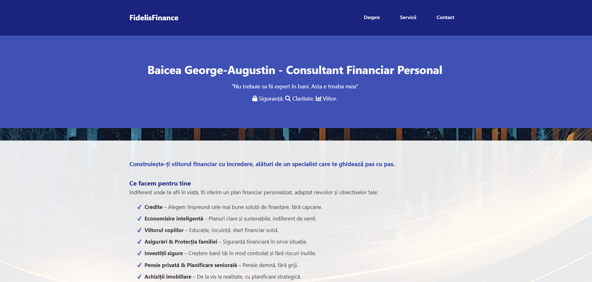
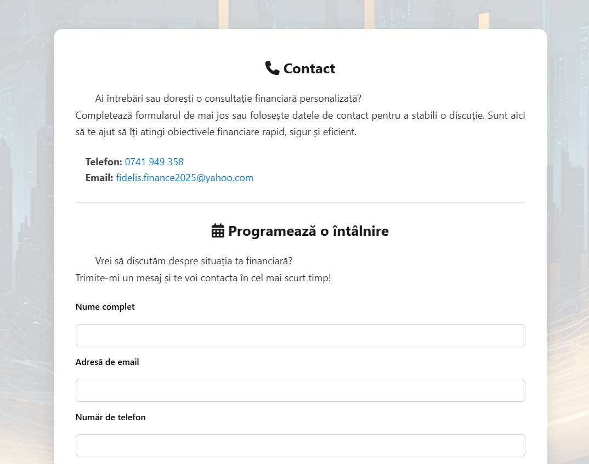
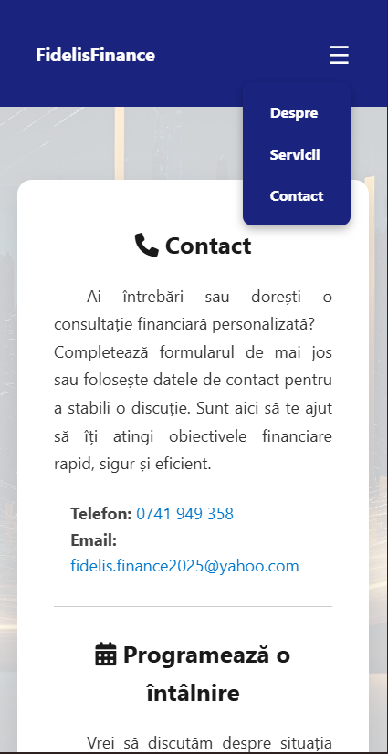

# FidelisFinance – Financial Consulting Website

Presentation website built for a real client, a personal financial consultant. The site presents the consultant's services (loans, savings, investments, insurance, retirement planning) and lets visitors get in touch through a contact form that sends emails automatically.

## Features

- **Four pages**: Home, About, Services, Contact, rendered with Flask and Jinja2 templates
- **Contact form with automatic emails** (Flask-Mail over SMTP/SSL):
  - the consultant receives the visitor's message, with *Reply-To* set to the visitor's address
  - the visitor receives an automatic confirmation email
- **Responsive layout** with a mobile hamburger menu
- **Basic SEO**: meta descriptions, page titles and a `sitemap.xml`
- Credentials kept out of the code, in environment variables (`.env`)

## Tech stack

- Python, Flask, Flask-Mail, python-dotenv
- HTML5, CSS3 (separate stylesheet per page), Jinja2
- Font Awesome icons

## Project structure

```
FidelisFinance-Website/
├── app.py              # Flask routes and contact form email logic
├── templates/          # index, despre (about), servicii (services), contact
└── static/             # CSS, images, favicon, sitemap.xml
```

## How to run locally

1. Install the dependencies:
   ```bash
   pip install flask flask-mail python-dotenv
   ```
2. Create a `.env` file next to `app.py`:
   ```
   DEL_EMAIL=sender-address@gmail.com
   PASSWORD=gmail-app-password
   REC_EMAIL=consultant-address@example.com
   ```
   `PASSWORD` is a Gmail **App Password**, not the account password.
3. Start the server:
   ```bash
   python app.py
   ```
4. Open `http://127.0.0.1:5000` in a browser.

## Screenshots

**Home page**



**Contact page and form**



**Mobile view with the navigation menu open**


